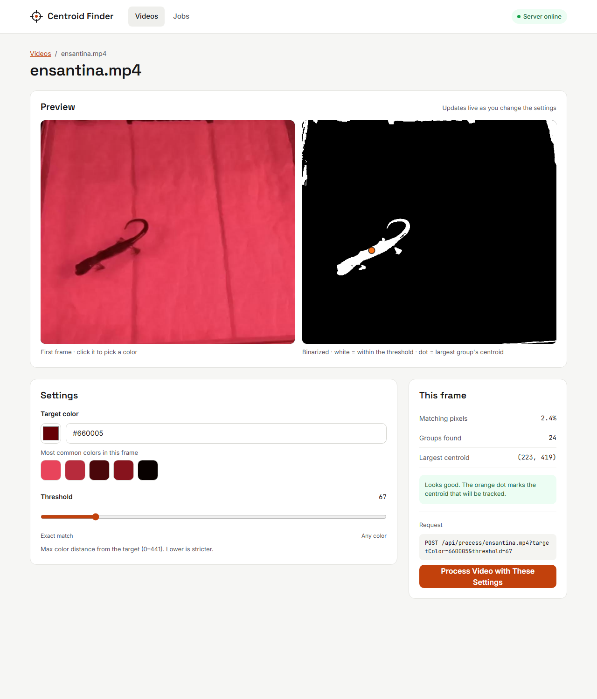
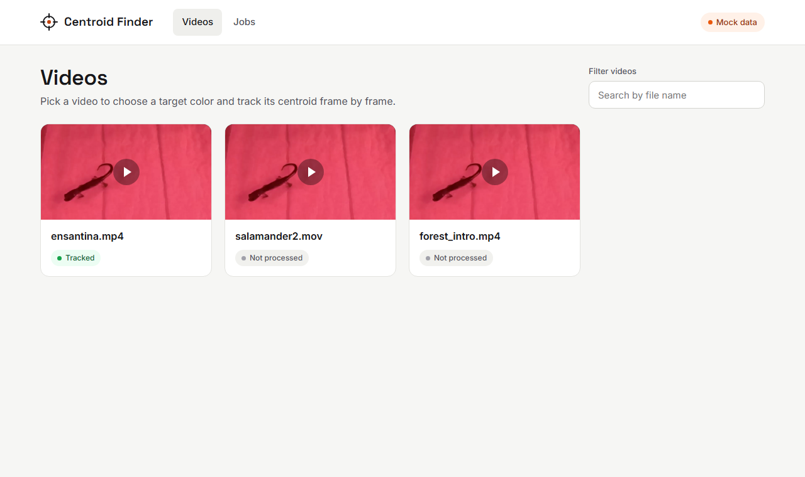
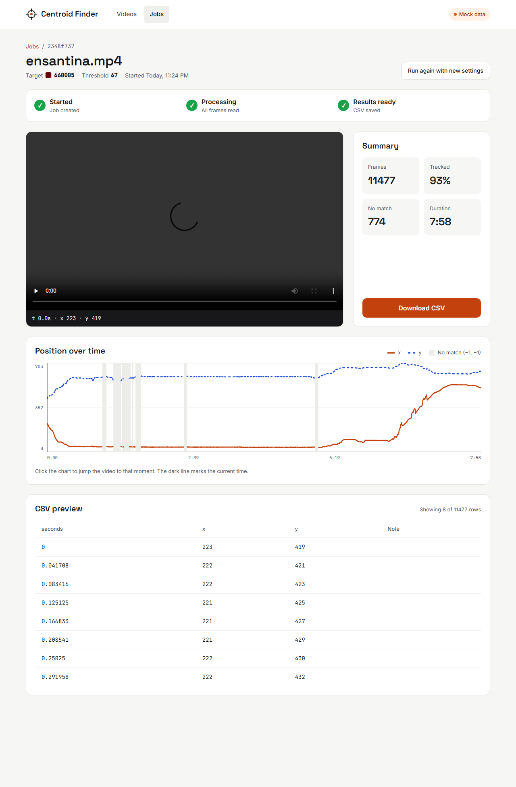
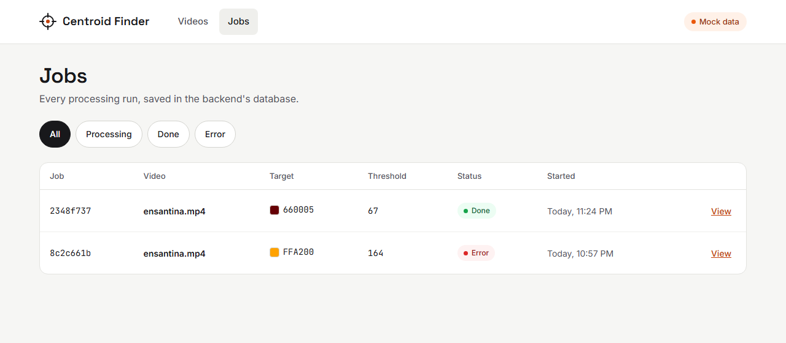

# Centroid Finder

Track an object (like a salamander) through a video. Pick a video, tune a target color and threshold while watching a live black-and-white preview of the first frame, then process the whole video. The result is a CSV with the position of the largest matching object in every frame.



The project has three parts:

| Folder | What it is |
| --- | --- |
| [`processor/`](processor/) | Java video processor. Reads every frame with JavaCV, binarizes it against the target color, finds connected groups with DFS, and writes `seconds,x,y` for the largest group's centroid (`-1,-1` when nothing matches). Builds to `videoprocessor.jar`. |
| [`server/`](server/) | Spring Boot API (port 8080). Lists videos, serves thumbnails and video files, runs the processor as a background job, and saves job status in SQLite. |
| [`centroid-webpage/`](centroid-webpage/) | React + TypeScript frontend (Vite). Video Chooser, live preview and tuning, job tracking, results and job history. |

The original single-image version (`ImageSummaryApp`) is in [`src/`](src/), with sample images in `sampleInput/` and `sampleOutput/`. The original course instructions are in [`docs/assignment-instructions.md`](docs/assignment-instructions.md).

## Frontend features

| Requirement | Where |
| --- | --- |
| **Video Chooser** at `/videos`: lists videos from `GET /api/videos`, each linking to its preview | [`pages/VideoChooser.tsx`](centroid-webpage/src/pages/VideoChooser.tsx) |
| **Thumbnail preview** at `/preview/:filename`: first frame from `GET /api/thumbnail/{filename}`, side by side with a binarized version | [`pages/Preview.tsx`](centroid-webpage/src/pages/Preview.tsx), [`components/FramePreview.tsx`](centroid-webpage/src/components/FramePreview.tsx) |
| **Live tuning**: a threshold slider and color picker that update the binarized image in real time, with a dot at the largest group's centroid | [`components/SettingsPanel.tsx`](centroid-webpage/src/components/SettingsPanel.tsx) |
| **Java logic re-implemented in JavaScript** | [`lib/centroid.ts`](centroid-webpage/src/lib/centroid.ts) |
| **"Process Video with These Settings"**: sends `POST /api/process/{filename}?targetColor=<hex>&threshold=<int>` | [`components/JobPanel.tsx`](centroid-webpage/src/components/JobPanel.tsx) |
| **Job status**: checks `GET /api/process/{jobId}/status` every 2 seconds, then links to the CSV | [`hooks/useJobStatus.ts`](centroid-webpage/src/hooks/useJobStatus.ts) |
| **Higher-order component**: `withData` handles fetching, loading, errors, retry and polling | [`hoc/withData.tsx`](centroid-webpage/src/hoc/withData.tsx) |
| **Mock data** for working without the backend | [`mock/`](centroid-webpage/src/mock/) |
| **Automated tests**: 73 frontend tests (Vitest + React Testing Library), plus JUnit tests for the processor | `*.test.ts(x)` files, [`processor/src/test/`](processor/src/test/java/) |

### Unique features

- **Results page with the tracked path drawn over the video** (`/jobs/:jobId`). The video plays with the whole path and the current centroid drawn on top. A chart of x and y over time marks the frames with no match; click it to jump the video to that moment. There's also a summary (frames, % tracked) and a CSV preview.
- **Job history** (`/jobs`): every run saved in the server's SQLite database, with status filters. It refreshes itself while a job is still processing.
- **Pick the color from the frame**: click the salamander in the first frame to use its exact color (the average of the 5×5 pixels under the cursor).
- **Suggested colors**: the swatches are the most common distinct colors in the first frame.
- **Hints**: the preview warns when nothing matches, when too much of the frame matches, or when there's a lot of noise.
- **"Run again with new settings"**: opens the preview with a past job's settings already filled in.

## The Java logic in JavaScript

[`centroid-webpage/src/lib/centroid.ts`](centroid-webpage/src/lib/centroid.ts) has one function per Java class in `processor/`:

| Java | JavaScript |
| --- | --- |
| `EuclideanColorDistance.distance` | `euclideanDistance` |
| `DistanceImageBinarizer.toBinaryArray`: white when `threshold > distance` | `binarize` |
| `DfsBinaryGroupFinder.findConnectedGroups`: iterative DFS, 4-connected, integer-average centroid | `findConnectedGroups` |
| `Group.compareTo` (sorted largest first: size, then x, then y) | `compareGroupsDescending` |
| `CentroidTracker.findLargestCentroid`: `(-1, -1)` when nothing matched | `findLargestCentroid` |

The only difference is the data shape: the browser gives pixels as one flat array (`index = y * width + x`) rather than `int[][]`. [`centroid.test.ts`](centroid-webpage/src/lib/centroid.test.ts) repeats the JUnit test cases with the same expected values.

As a check: for the sample video with target `660005` and threshold `67`, the browser preview puts the largest centroid at **(223, 419)**. That's exactly the first row of the CSV the Java processor wrote (`0.0,223,419`).

## Setup

You need:
- Java 17 or newer and [Maven](https://maven.apache.org/), for the processor and server
- [Node.js](https://nodejs.org/) 20 or newer, for the frontend
- [Git Bash](https://git-scm.com/downloads) on Windows (the commands below are Git Bash / bash)

```bash
git clone https://github.com/SamuelM007/centroid-finder.git
cd centroid-finder
```

### 1. Build the processor (once)

```bash
cd processor
mvn package
cd ..
```

This creates `processor/target/videoprocessor.jar`, which the server runs for each job.

### 2. Start the server

Videos go in `server/videos/`. `.mp4` files aren't in git, so copy the sample salamander video there yourself:

```bash
mkdir -p server/videos
cp /path/to/ensantina.mp4 server/videos/
```

Then start the server. Run it from inside `server/`, because it finds `videos/`, `metadata/` and the processor jar relative to that folder:

```bash
cd server
mvn spring-boot:run
```

It runs at http://localhost:8080. Job outputs are saved in `server/metadata/`, and job status in `server/jobs.db`.

### 3. Start the frontend

In a second Git Bash window:

```bash
cd centroid-webpage
npm install
npm run dev
```

Open http://localhost:5173. Vite forwards every `/api` request to `http://localhost:8080`. If the server runs somewhere else, set `BACKEND_URL`:

```bash
BACKEND_URL=http://localhost:8081 npm run dev
```

### Frontend without the server (mock data)

```bash
cd centroid-webpage
npm run dev:mock
```

A "Mock data" badge shows in the header. The mock backend ([`src/mock/mockApi.ts`](centroid-webpage/src/mock/mockApi.ts)) keeps jobs in memory: a new job shows "processing" for 4 seconds, then finishes with a real CSV the processor produced for the sample video. To see the video play on the results page, copy the sample video to `centroid-webpage/public/mock/ensantina.mp4`.

## Testing

**Frontend**:

```bash
cd centroid-webpage
npm test
```

The tests use [Vitest](https://vitest.dev/) and [React Testing Library](https://testing-library.com/docs/react-testing-library/intro/) in a simulated browser (jsdom). Network calls are replaced with a fake `fetch` ([`src/test/fetchMock.ts`](centroid-webpage/src/test/fetchMock.ts)), so the server doesn't need to be running.

| Test file | Covers |
| --- | --- |
| `lib/centroid.test.ts` | The Java port: color distance, binarizing (strict `>`), connectivity, centroids, ordering, `(-1, -1)` |
| `lib/csv.test.ts`, `lib/palette.test.ts`, `lib/format.test.ts` | CSV parsing and gaps, suggested colors, date and time formatting |
| `hoc/withData.test.tsx` | The HOC: loading, data, error + Retry, polling |
| `pages/VideoChooser.test.tsx` | Video list, links to `/preview/...`, statuses, filtering, error state |
| `components/SettingsPanel.test.tsx` | Slider, hex field, color picker, swatches |
| `components/JobPanel.test.tsx` | The POST URL and settings, status polling, CSV link, failures |
| `pages/Jobs.test.tsx` | Job table and status filters |
| `App.test.tsx` | Routes: `/` → `/videos`, `/preview/:filename`, settings from the URL, 404 |
| `mock/mockApi.test.ts` | The mock backend's job lifecycle |

**Processor** (JUnit):

```bash
cd processor
mvn test
```

### Frontend scripts

| Command (in `centroid-webpage/`) | What it does |
| --- | --- |
| `npm run dev` | Dev server using the real backend |
| `npm run dev:mock` | Dev server using mock data |
| `npm test` | Runs all tests once |
| `npm run test:watch` | Re-runs tests as files change |
| `npm run lint` | ESLint |
| `npm run build` | Type-checks and builds to `dist/` |

## API

| Endpoint | Returns |
| --- | --- |
| `GET /api/health` | `Server is Running!` |
| `GET /api/videos` | `["ensantina.mp4", ...]` |
| `GET /api/thumbnail/{filename}` | First frame as a JPEG |
| `GET /api/video/{filename}` | The video file (supports seeking) |
| `POST /api/process/{filename}?targetColor=RRGGBB&threshold=N` | `202 {"jobId": "..."}` |
| `GET /api/process/{jobId}/status` | `{"status": "processing" \| "done" \| "error", "result": "/api/result/{jobId}"}` |
| `GET /api/jobcheck/{jobId}` | Same as the status route above |
| `GET /api/result/{jobId}` | The CSV, `seconds,x,y` per frame |
| `GET /api/jobs` | Every job, newest first: `id, fileName, targetColor, threshold, status, createdAt` |
| `GET /api/jobs/{jobId}` | One job |

## Project structure

```
processor/            Java video processor (JavaCV) -> videoprocessor.jar
server/
  api/                ApiApplication, VideoController, JobRepository (SQLite)
  videos/             input videos (not in git)
  metadata/           job output CSVs
centroid-webpage/
  src/
    api/              types, the real API client, and the switch between real and mock
    mock/             mock videos, jobs and a mock API
    lib/              centroid.ts (Java port), csv, palette, color and format helpers
    hoc/              withData higher-order component
    hooks/            useJobStatus (polls a job's status)
    components/       Header, VideoCard, FramePreview, SettingsPanel, JobPanel, PositionChart, StatusPill
    pages/            VideoChooser, Preview, Jobs, JobResults
  public/mock/        mock thumbnail and CSV
docs/screenshots/     the screenshots below
src/                  original single-image ImageSummaryApp
```

## Screenshots

**Video Chooser** (`/videos`)



**Preview and processing** (`/preview/ensantina.mp4`): the first frame, its binarized version with the centroid, and the settings


**Results** (`/jobs/:jobId`): tracked path, position chart, summary and CSV preview



**Job history** (`/jobs`)


